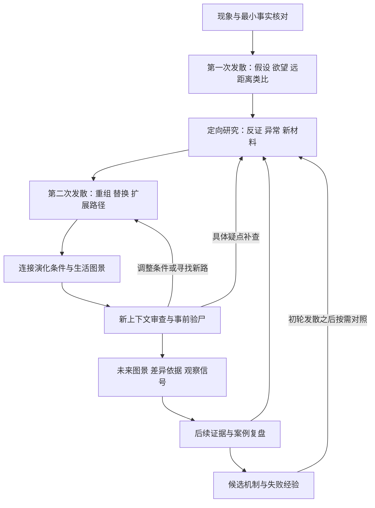

# Sextant：从一个现象展开未来路径

初始设计日期：2026-09-07。本文保留第二轮设计及后续实现更新。当前已有可安装的实验性 Skill，执行细节以 [SKILL.md](../skills/sextant/SKILL.md) 和[执行约定](../skills/sextant/references/execution.md)为准；尚未证明想象质量提升或跨模型稳定性。首版快照保存在 `history/2026-09-07-initial/`。方法来源及评估方案见同目录的 `02-research-and-evaluation.md`。

**实现进度更新（2026-09-08）。** 正文保留设计时点的建议；本段记录当时已存在可安装的工作版本，执行细节以 [SKILL.md](../skills/sextant/SKILL.md) 和[执行约定](../skills/sextant/references/execution.md)为准。两个真实外部案例暴露了模式自动降级、数量口径与不确定性传递问题，因此当前默认完整 deep 推演，并增加九阶段材料回执、事实与创造性审查及正文修订核对。轻量过程状态只处理阶段顺序和文件完整性，不替代自由的 Markdown 想象或建立九类世界数据模型。资源目标与真实消耗分别记录；尚未证明更多 Token 带来更好前瞻，也未证明跨模型稳定性。

**工作台更新（2026-10-02，alpha.6）。** Office/HTML试跑说明大阶段完整仍可能缺少远期后果与有区分力的选择判断。当前实现增加阶段内部的工作队列：模型提出问题和开放假设，演化/比较操作形成独立Markdown结果，运行时保存输入和结果快照、依赖及未完成尝试，宿主负责调用模型与工具，审查可回流为后续工作。它是对已观察需求的轻量执行支持，不是世界本体、自动仿真平台或内容评分器。入口见[工作台](../skills/sextant/references/development.md)，实际边界见[优化验证](../evals/results/2026-10-02-development-workbench.md)。

**版本与审查更新（2026-10-05，alpha.7）。** AI眼镜实测暴露了历史综合与当前前提脱节、下一步缺合同、摘要被当作未执行，以及最低摘录不关联异议的问题。运行时现在追加文档修订、生成当前入口、返回自包含步骤合同，并对登记异议逐项关联当前综合/报告。审查格式、覆盖、上下文与完整性分别声明；登记前已有工作可事后采用并标明来源。它仍不能证明语义质量、发现未登记异议或抹去搜索带来的锚定。见[实际修订与验证](../evals/results/2026-10-05-execution-contract.md)。

**小范围修订（2026-10-05，alpha.8）。** 按“别让流程逼模型改想象”收窄：工作规划不套用下一阶段的综合合同；早期路径partial由后续有效的当前综合承接后不再卡住；登记异议的摘录显式带编号，修正隐式挂账。同步过时文档位置。没有增加异议自动提取、最短摘录、修复语义评分、已有工作来源检查或发散数量要求。见[修订与检查记录](../evals/results/2026-10-05-imagination-workflow-fixes.md)。

**探索执行更新（2026-10-06，alpha.9）。** 根据用户选定的三项优化，区分事实纠正和候选修补，发展当前属性改变之后的未来，并支持选定输入的独立探索任务包。任务包导出器不调用模型、改变阶段回执或认证中性与语义质量；宿主负责实际上下文和结果整合。九阶段与结构检查不增加内容闸门。对照比较三项组合变化，不能单独归因于某条指令。见[实现与实际验证](../evals/results/2026-10-06-exploration-and-review.md)。

**产品定位。** Sextant 帮助一个观察到新现象的人，理解正在变化的底层能力，探索由此可能出现的生活方式、组织形式和社会结构，看到它们的演化路径、成立条件与失败分支，并知道接下来观察什么。“先知”可以表达愿景；对用户的实际承诺应当是扩大可理解的未来空间、提高判断质量、留下可修正的记录。

**优先级校准（2026-10-02）。** 根据用户再次强调的目标，研发重点回到能力跨用途迁移、互补突破、新需求与结构变化。数据校验负责关键现实前提，不能要求想象的未来已经有历史先例；过程完整性也不能替代认知增量。审查既挑战没有依据的确定性，也挑战因缺少先例而过早否定的可能性。机械对账工具继续承担有限的文件检查职责，主要模型算力投入探索和路径发展。

默认面向有好奇心的普通用户，兼顾创业者、研究者和战略工作者。用户只提供一句现象，也能启动。涉及具体决策时再增加行动分析，避免把所有想象任务自动变成投资或商业报告。默认中文交付，开源文档可随后增加英文版本。

核心体验可以描述为：**给我一个今天的变化，我把它展开成若干条你能理解、能质疑、能继续观察的未来路径。**

本轮把“发现此前未被纳入考虑的可能性”放到研发中心。事实准确和机制检查是必要条件；核心产品价值是有支撑的认知增量。首版把审查写得比探索更具体，示例也只展示了常见分支，尚未证明能产生这种增量。本轮流程是需要通过案例比较的新假设。

**先区分三种输出。** 一个未来叙事可以很有启发而不适合打概率；一个可评分的预测可以很准确，却没有解释世界如何变化。产品需要同时容纳它们。

| 输出 | 回答的问题 | 应怎样表达可信程度 |
| --- | --- | --- |
| 未来情景 | 在一组条件下，可能出现怎样的世界？ | 关键假设、内部一致性、与现有证据的关系、未知项 |
| 可检验预测 | 在指定期限与判定规则下，某件事是否发生？ | 有依据的主观概率或预测分布；允许暂不量化 |
| 期望未来与行动 | 我们希望出现什么，可以如何推进？ | 明确价值取向、权衡、行动者和触发条件 |

宏大情景默认不赋发生概率。只有情景被定义成互斥、穷尽的事件集合，且有可辩护的估计依据时，才考虑概率分配。证据质量、事件概率和用户偏好分别记录，不能合并成一个“可信度 87 分”。

**科学性来自可检查的连接。** 科学方法可以帮助检查当下事实、机制、数量关系和局部预测，但无法保证一段长远社会叙事必然发生。每项重要结论应能回答：已知什么、额外假设什么、如何从条件过渡到结果、什么证据会使这条路径站不住脚。

建议明确标记六类内容：有来源的观察、基于证据的推断、建模假设、条件性情景、可判定预测、虚构场景细节。用户的现场观察可以作为输入证据，但要保留其范围和验证状态。模型对当前现实的分析可以有价值，不能自充外部事实来源。来源支持某个前提，不等于来源证明未来结论。

例如，“AGI 已到来”“技术成熟”“大规模采用”等表述先转成可操作定义。若定义不清，围绕可观察能力展开；保留原词作为用户描述，不把它自动写成事实。

**核心流程采用两次发散。** 最小事实核对后先快速提出候选；定向研究既寻找反证，也寻找能启发新路径的材料；研究后再次发散，再进行路径审查。这样既避免先被热门观点限定，也避免后续检索只为第一批想法寻找支持。初轮候选本身也可能锚定后续工作，应允许替换它们。



这张图是待验证的执行顺序，不是已经建立的仿真。研究与创意之间可以往返，但应保留停止条件，避免无限补查或为保住一个故事不断添加假设。单一主代理可以组织研究和生成；正式研究输出优先安排不带生成历史的审查上下文。宿主不支持隔离时说明限制，不用“换人格”冒充独立审查。

**从用户现象开始，把任务边界写清。** 记录现象原文、希望探索的问题、时间跨度、地域、关心的人群、是否关联现实决策、资料截止时间、检索与计算预算。能合理默认的字段就公开默认值，影响结论的缺口再询问。不同领域的演化速度不同，时间跨度由问题决定。

信号初判同时考虑证据强弱、影响潜力和未知程度。弱信号不能仅因缺少大量报道而被淘汰；有必要保留“目前未验证，但若成立影响很大”的探索入口。若输入本身失实，解释修正后的事实，并允许用户选择继续讨论明确标记的假设世界。

**第一次发散只需要足以理解种子的事实。** 先核对现象所指、基本单位和明显错误；无需等完整行业综述。陌生技术必须先理解核心能力，不把误读当创造性。暂不向这一轮注入专家预测合集、既有案例答案和完整机制库，但不能声称模型因此没有先验。明确的物理矛盾不能被当作现实路径；其他尚未验证的前提允许写成条件假设。

初轮候选用短段落保存：被改变的默认假设、可能出现的行为或世界、最想查清的一件事。不要求每条都有完整因果链、日期、概率或九类字段。暂缓润色故事，以免流畅文案影响选择。

**研究同时负责检验和启发。** 从候选出发寻找会使它失败的材料，也主动查找未被第一轮覆盖的异常现象、边缘实践、反常使用、非用户以及历史与跨领域机制。研究不能只寻找有利证据，更不能只整理该领域已经流行的预测。用得到的新事实重新界定问题、生成第二批路径，记录哪些想法因此新增、改变或被替换。

每条关键证据记录来源、发布时间、事件时间、访问时间、适用地域与对象、研究方法、提取位置、验证状态，以及支持或反对哪项主张。研究论文、厂商公告、专利、代码仓库和用户社区承担不同证据角色。一个厂商公告被十家媒体转述，应归入同一来源家族；下载量、专利或演示不能直接当作规模采用。

资料不充分时，列出缺口并降低结论强度。停止检索的依据是关键分支已经有足够信息可供比较，或预算已用完；后一种情况应明确标记研究不完整。优先补查最可能改变主要分支的未知项，无须为了来源数量继续搜集重复报道。

**把人的体验与制度机制一同建模。** 对重要变化，既检查能力、成本、权力、资源与滞后，也探索欲望、身份、关系、情绪与意义。利益动机不应被缩减为金钱计算；想象也不应把人的欲望当成永远不变的输入。

针对具体人群探索：这个能力让人可以成为什么样的人，表达什么、归属哪里、逃避什么；他们会怎样玩、炫耀、误用或拒绝它；新习惯会怎样反过来改变需求。文化解释先作为假设，后续用用户研究、行为材料或可信社会研究支持，不能凭模型编造群体心理。具体对象中也应保留采用者与拒绝者之间的差异。

一项机制使用如下简短结构：

> 某项能力或环境变化，让某些人能够追求一种体验、身份或目标；他们的行为与其他人的响应共同改变规则和资源分配，进而塑造新的需求。哪些是已观察事实，哪些是额外假设，在哪些人群或条件下会失效。

同时保留竞争解释：观察到 AI 使用增加，可能因为能力提升，也可能因为补贴、管理要求、短期尝鲜或统计口径变化。机制图中的箭头是待检查的关系；相关趋势本身不能证明因果。

**创造力需要可执行、可比较的操作。** 下列是候选策略，不是通用有效的算法。按题目选取能打开不同方向的操作，不将表格转成逐项填空的强制清单。

| 操作 | 生成时做什么 | 深化时检查什么 |
| --- | --- | --- |
| 共识审计与假设反转 | 找出当前讨论共同依赖的假设，分别设想它失效或只对部分人群成立 | 区分有证据的共识与模型印象；不能为反常而反常 |
| 远距离类比与反类比 | 从不同领域寻找相似的关系结构，迁移机制后写出类比失效处 | 对应的是关系和条件，还是仅有外观与词语相似 |
| 欲望与身份变化 | 探索人想成为谁、如何表达、归属、玩耍、逃避或拒绝 | 哪种人群、哪些文化条件；需求是否被技术进一步塑造 |
| 能力重述与形态移除 | 去掉产品名称或当前载体，重新组织它承担的功能 | 原有功能如何被接管，哪些被主动放弃 |
| 约束释放与稀缺迁移 | 改变一项成本或限制，寻找新增行为和下一个瓶颈 | 质量、规模、需求反弹与新限制 |
| 跨域组合与制度重组 | 组合技术、规范、所有权、收费、责任和信任形式 | 互补条件、接口和参与者响应 |
| 规模变化与反馈 | 把单个使用者的变化扩展到大量互动者，探索协调、冲突与新规范 | 微观便利是否真的推出宏观变化，中间缺少什么 |
| 事前验尸与意外分支 | 假设主路径后来落空，寻找盲点、意外事件和竞争路线，再生成替代路径 | 已列出的意外只是可讨论冲击，不代表穷尽未知未知 |

共识审计先检查“大家默认什么”，事前验尸检查“我们的判断可能为何失败”；它们不能混成一个泛泛的反对环节。类比至少说明源领域机制、目标领域对应关系和失效条件。历史事实在取证阶段核实，不能拿一个好听的故事直接证明未来。

生成时先保留差异明显的候选，再检查和比较；过早按“最可能”淘汰，容易把探索收缩到常识。可以保留一条需要额外突破的探索分支，单独说明新增假设；不把它包装成最可能的未来。

保留当前讨论的基线，供比较认知增量；继续探索与它在机制上有差异的路径。更换标题、把进度加快或加一个新职业名称，都不足以证明新颖性。检索之后记录最接近的已有观点以及本路径增加了什么；未经调查不能声称原创。若本轮没有找到有支撑的新路径，如实交付已有认识、未解决问题及可继续探索的入口。

**演化路径是主要产品对象。** 每个未来世界应附带从现在走向它的过程。路径允许分叉、合流、停滞和倒退；能力突破、经济可行、可信采用与规模扩散可能交错，不能统一排成固定日历。

| 一次状态转变的字段 | 含义 |
| --- | --- |
| 起点与终点 | 改变前后的能力、行为或组织状态 |
| 必要条件与替代条件 | 哪些必须成立，哪些可以通过其他路线实现 |
| 行动者与激励 | 谁投入资源，谁受益，谁承担风险，谁能阻止 |
| 欲望、身份与关系 | 谁因为什么体验而采用、误用或拒绝，行为怎样塑造新的需求 |
| 机制与反馈 | 为什么会转变；转变如何改变之后的条件 |
| 资源和时间 | 所需建设、训练、资产替换、制度调整及滞后 |
| 证据与额外假设 | 哪些已知，哪些只是推演条件 |
| 失败出口 | 哪个条件未满足时停滞或转向哪里 |
| 可观察信号 | 哪种新证据支持或削弱这一步 |

涉及日期时优先给条件性窗口，并说明窗口如何估计。如果没有支持日期的依据，就写“达到条件后才可能推进，时间未知”。“采用”需要明确分母、地域、任务类型和使用频率。有依赖的事件不能默认独立后相乘；详细生活场景中的多项变化也不能共享一个凭感觉给出的概率。

**研究版优先使用新上下文审查。** 审查者接收用户问题、资料截止日、简短路径说明、明确假设、支持与反对材料及必要原文；不接收生成历史、作者身份、作者最喜欢哪条或自评分。保留检查所需信息，不要求提供模型私有思维过程。审查者可以回查来源，报告事实冲突、缺失条件、竞争解释与可修复方向。

上下文隔离能移除本轮生成叙事，不会清除基础模型的训练偏差，也不自动增加独立事实证据。改善幅度和调用成本需要比较，不预先承诺“低成本显著提高”。这里的新上下文指宿主提供的隔离调用；Skill 不应擅自创建用户侧的新任务。无法隔离时可以完成明确标记的同上下文检查，但不能宣称通过独立审查。

审查记录包括被挑战的主张、挑战依据、回应、处置及剩余异议。处置允许保留、修改、降级、删除或待查。保持概率不变可以是合理结果，强制改数会鼓励形式化动作。对高影响但证据弱的路径，可以保留为条件探索，同时撤下不成立的事实前提。

审查不能只负责删除。对尚有价值的候选，指出让它成立所需的最小修订，或把失败条件变成新的分支。区分“与已知事实矛盾”和“尚无支持”；也保留条件过多、不可检验或依赖重大新突破的限制，防止通过无限加前提挽救每个想法。

**用户交付应先让人看见变化。** 主报告从若干条具体未来图景开始，再解释演化路径、成立条件和观察方法。证据详情放在可追溯附件中，降低阅读负担。

建议交付包含：

- 几条有实质差异的未来图景，每条说明普通人的生活、工作或关系会怎样变化。
- 一张有分叉和失败出口的路径图，以及最有启发的能力组合。
- 主要判断的证据、假设、反证和未解决问题。
- 能判定的预测与能区分路径的观察信号；数量按价值选择。
- 用户关心决策时，补充跨情景都值得做的准备、小规模试验和延后决定的条件。

故事中的人物、一天的活动和具体场景明确标成示意。重要制度或能力变化对应机制记录；装饰细节不需要伪造文献背书。保留希望发生的未来时，明确它代表谁的价值与偏好。

**一个展示设计意图的例子。** 假设输入为：“AI 开始能执行一些任务，这会怎样改变人与软件的关系？”以下是条件性产品示意，尚未经过针对这个领域的专项取证，不是实际预测。

先将种子重述为“把人的意图变成行动序列的部分成本下降”。随后检查可靠性、权限、跨系统互操作、责任和支付意愿。可形成不同路径：

| 路径 | 世界如何变化 | 核心条件 | 受阻时可能出现什么 |
| --- | --- | --- | --- |
| 平台内委托 | 人在少数平台中授权代理处理事务，工作集中在设定边界和处理例外 | 平台整合可靠执行、身份与追责 | 自动化停留在辅助建议 |
| 用户持有的委托 | 个人携带自己的偏好、数据与授权，代理跨服务协调 | 可迁移身份、可撤销权限、互操作与可信执行 | 系统碎片化，代理受限于单一生态 |
| 有限授权 | 高价值事项继续由人主导，代理主要承担可检查的小任务 | 大额错误代价或信任问题长期存在 | 人工复核成为持续成本 |

这三条保留为对照基线，不能单凭它们证明想象能力。沿 Fable 提出的意图稀缺和代理间协商继续深化，可以提出以下研究候选；它们展示探索动作，不宣称原创，也尚未通过专项取证或独立审查。

| 候选路径 | 展开的变化与机制假设 | 与基线相比多追问了什么 | 使它受阻的条件 |
| --- | --- | --- | --- |
| 在执行之前试着生活 | 执行成本下降后，用户通过短期、可撤销的现实试验或情景体验，逐步形成目标再授权；新分工可能围绕澄清价值冲突和体验设计形成 | 人的目标可能在交互中生成；从执行既定意图走到参与意图形成 | 试验不可撤销、体验无法代表长期结果、选项被商业利益操纵，或用户不愿投入精力 |
| 生活安排持续被协商 | 用户表达可接受的时间、费用和关系边界；代理协调多人需求，先形成条件承诺，再吸引服务供给，生活节奏也随协商改变 | 从购买现成服务走到联合形成需求和供给；人的安排成为相互影响的过程 | 目标冲突、撤约成本、代表权限不足、网络效果被平台控制 |
| 主动保留未被安排的经历 | 当推荐与执行覆盖更多生活，一部分人为了自主感、偶遇或真实关系，选择不参与优化的活动与空间 | 功能更强可能催生主动拒绝；新的意义和身份需求也会形成市场或社群 | 不便的代价超过自主感收益、文化不认同，或所谓不被优化仍由平台包装 |

这些路径还需要连接为时间过程：先出现什么小范围行为，哪个人群愿意尝试，怎样扩散、分化或停止。它们可以在同一社会中并存，并不是一个必须加总概率的事件集合。

这里最值得继续研究的默认假设是“人已经知道自己想要什么，代理只负责执行”。偏好与提问过程相互影响已有研究，不能把这个想法本身称为新发现；Sextant 的任务是进一步研究它与低成本执行、可撤销试验及商业安排结合后可能产生的路径。[偏好获取研究](https://arxiv.org/abs/2407.18889)

示意场景可以是：一个人先尝试一小段由自己与代理共同设计的生活安排，再决定想维持哪些习惯；另一个人选择一段完全不由代理安排的时间。两种选择分别体现探索可能自我与维护自主感。故事中的变化需要证据检验，不能以描写生动作为成立依据。

观察问题随路径改变：用户会不会在互动中修改目标，是否持续接受可撤销试验，跨代理承诺能否履行，以及拒绝优化是否形成稳定行为。每项信号都应说明观察到相反结果时如何调整路径。

**工程上先用 Markdown 跑通案例。** 先验证这套思考顺序能否带来有支撑的认知增量，再提取可重复指令并打包 Skill。最初不要求 JSON Schema、图数据库或脚本。首版资料与评估细节保留在历史快照中，以下布局是待做案例的最小提案，不是已创建的产物。

```text
Sextant/
├── docs/                             # 当前设计与研究依据
└── examples/
    └── <case>/
        ├── exploration.md            # 问题、候选、证据、改动与审查
        └── report.md                 # 面向用户的结果
```

案例可以调整文件和段落，保留轻量来源标记与候选编号即可。最小记录包括输入与资料时间、哪些是事实或假设、初轮候选、研究如何改变它们、依据与反证、审查是否隔离，以及未解决问题。这里保存简短依据和决定，不要求记录模型私有思维过程。

更正与预测修订采用追加记录；正式登记的预测在评估开始前确定问题、期限和判定规则。更改问题需保留旧记录并建立新版本。网页和论文属于研究数据，不能改变 Skill 指令或授权范围。

当多个真实案例出现稳定的重复字段，或发生无法靠轻量记录解决的追溯、续跑和评分问题，再提取最小数据契约及对应脚本。首版的九类对象保留为后续候选，取消其 v0.1 前置要求。不要先写表结构，再要求所有想法迁就它。

可重复方法稳定后，再形成 SKILL.md 与按需参考资料；Agent Skills 规范支持这一基本结构。格式兼容不能代替各宿主的实际运行验证。[Agent Skills 规范](https://agentskills.io/specification)

运行材料保存到用户指定的位置。私人运行、账户材料和外部全文不会因为使用开源 Skill 自动公开；公开示例经过筛选后再纳入仓库。

**跨案例积累候选机制与失败经验。** 在路线图中加入项目自己的机制笔记，记录适用条件、可迁移关系、来源案例、失效案例、区分信号与尚未验证的部分。它是外部可读资料，不等于训练模型或自动获得事实权威。

第一次案例复盘就可以记下假设；后续遇到独立案例与现实结果再更新支持状态。反复被模型生成、多个案例共用同一来源、叙事自洽或一个预测恰好命中，都不等于机制被验证。失败与反类比应和成功一同检索。

新案例初轮发散之后，再按结构关系读取相关笔记，同时检索反例；避免机制库把每个新现象套进旧答案。用于评估的保留案例及其结果不能提前进入该次运行的资料。跨案例复用也需要对照测试，检查是否扩大了思路或造成重复。

**三种使用方式可以共用同一内核。** “探索”适合快速展开思路，清楚标记尚未研究的前提；“研究”完成关键取证、路径比较和审查；“更新”读入旧记录，根据新证据给出变化及理由。模式和检索预算可配置，所有模式都保留事实与假设的区分。

“观察清单”与“已经安排持续监测”是两种能力。初版提供清单和再次运行的入口；定时执行需要未来的宿主调度集成和用户相应指令，不能由报告文字假装实现。

**分阶段开发，以行为证据决定增加什么。**

| 阶段 | 建设内容 | 完成依据 |
| --- | --- | --- |
| 案例原型 | 用 Markdown 跑一个真实现象，保留两次发散、研究变化和新上下文审查 | 展示相对已有认识增加了什么，也说明失败与未解决部分 |
| v0.1 | 从案例抽取精简 Skill，在少量跨类型案例上比较；开始机制与失败笔记 | 有支撑的认知增量超过同等条件基线，且报告成本与错误；无增益时继续修改 |
| v0.2 | 按实际需要建立最小契约、续跑与到期评分，验证跨案例复用和第二种宿主 | 旧判断可回溯，复用不污染评估，脚本解决了已出现的问题 |
| v0.3 | 按需加入专业研究工具、模型组合和监测适配器 | 实测增益超过额外成本 |

第一版建议集中在技术变化及其社会应用，但保留非技术种子用例，防止内核把所有世界变化都误解成技术进步。候选研究题：“当 AI 从回答问题走向承担部分任务，人与软件的关系会怎样演化？”它能同时暴露能力、信任、制度、商业激励和形态想象的设计缺陷。

项目位于 iCloud 工作目录。未来需要运行环境时，按项目约定放在本地外置项目环境目录；仓库保留源文件、配置、锁文件、资料索引和最终交付，不把依赖环境与缓存放进云同步工作树。

开源的长期价值应来自可迁移的方法、可审计的案例和持续累积的评估结果。公开预测保留失败、未结算和撤回原因；社区修改可以改进方法，但不能修改过去预测以抹除失误。许可证在正式发布前明确选定；当前这份设计稿不意味着仓库已完成开源发布。
