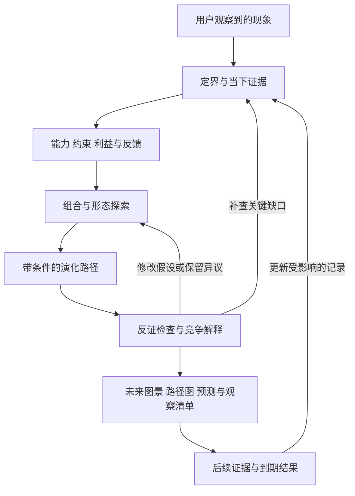

# Sextant：从一个现象展开未来路径

设计日期：2026-09-07。状态：产品与架构建议稿；尚未实现为可安装 Skill，也未验证预测效果。本文的模块、流程和验收方案是本项目的设计提案，方法来源及研究边界见同目录的 `02-research-and-evaluation.md`。

**产品定位。** Sextant 帮助一个观察到新现象的人，理解正在变化的底层能力，探索由此可能出现的生活方式、组织形式和社会结构，看到它们的演化路径、成立条件与失败分支，并知道接下来观察什么。“先知”可以表达愿景；对用户的实际承诺应当是扩大可理解的未来空间、提高判断质量、留下可修正的记录。

默认面向有好奇心的普通用户，兼顾创业者、研究者和战略工作者。用户只提供一句现象，也能启动。涉及具体决策时再增加行动分析，避免把所有想象任务自动变成投资或商业报告。默认中文交付，开源文档可随后增加英文版本。

核心体验可以描述为：**给我一个今天的变化，我把它展开成若干条你能理解、能质疑、能继续观察的未来路径。**

**先区分三种输出。** 一个未来叙事可以很有启发而不适合打概率；一个可评分的预测可以很准确，却没有解释世界如何变化。产品需要同时容纳它们。

| 输出 | 回答的问题 | 应怎样表达可信程度 |
| --- | --- | --- |
| 未来情景 | 在一组条件下，可能出现怎样的世界？ | 关键假设、内部一致性、与现有证据的关系、未知项 |
| 可检验预测 | 在指定期限与判定规则下，某件事是否发生？ | 有依据的主观概率或预测分布；允许暂不量化 |
| 期望未来与行动 | 我们希望出现什么，可以如何推进？ | 明确价值取向、权衡、行动者和触发条件 |

宏大情景默认不赋发生概率。只有情景被定义成互斥、穷尽的事件集合，且有可辩护的估计依据时，才考虑概率分配。证据质量、事件概率和用户偏好分别记录，不能合并成一个“可信度 87 分”。

**科学性来自可检查的连接。** 科学方法可以帮助检查当下事实、机制、数量关系和局部预测，但无法保证一段长远社会叙事必然发生。每项重要结论应能回答：已知什么、额外假设什么、如何从条件过渡到结果、什么证据会使这条路径站不住脚。

建议明确标记六类内容：有来源的观察、基于证据的推断、建模假设、条件性情景、可判定预测、虚构场景细节。用户的现场观察可以作为输入证据，但要保留其范围和验证状态。模型对当前现实的分析可以有价值，不能自充外部事实来源。来源支持某个前提，不等于来源证明未来结论。

例如，“AGI 已到来”“技术成熟”“大规模采用”等表述先转成可操作定义。若定义不清，围绕可观察能力展开；保留原词作为用户描述，不把它自动写成事实。

**核心架构采用两个相互校正的循环。** 探索循环负责产生新路径；校验循环负责核对证据与成立条件。它们共享结构化记录。早期可以由同一个代理顺序执行，不需要为了角色数量搭建复杂代理系统。



这张图表达工作依赖，不是声称已经建立了数值仿真。第一版的机制图是显式假设模型；只有变量、方程、参数来源与验证条件足够时，才增加仿真。

**从用户现象开始，把任务边界写清。** 记录现象原文、希望探索的问题、时间跨度、地域、关心的人群、是否关联现实决策、资料截止时间、检索与计算预算。能合理默认的字段就公开默认值，影响结论的缺口再询问。不同领域的演化速度不同，时间跨度由问题决定。

信号初判同时考虑证据强弱、影响潜力和未知程度。弱信号不能仅因缺少大量报道而被淘汰；有必要保留“目前未验证，但若成立影响很大”的探索入口。若输入本身失实，解释修正后的事实，并允许用户选择继续讨论明确标记的假设世界。

**研究应围绕改变结论的问题展开。** 先拆出关键未知，再检索原始研究、数据、真实部署、成本、失败案例、制度及使用者行为。先构建能力与约束的描述，再对照专家叙事，有助于减少被现成热门观点锚定的机会；这个顺序应在评估中验证其价值。

每条关键证据记录来源、发布时间、事件时间、访问时间、适用地域与对象、研究方法、提取位置、验证状态，以及支持或反对哪项主张。研究论文、厂商公告、专利、代码仓库和用户社区承担不同证据角色。一个厂商公告被十家媒体转述，应归入同一来源家族；下载量、专利或演示不能直接当作规模采用。

资料不充分时，列出缺口并降低结论强度。停止检索的依据是关键分支已经有足够信息可供比较，或预算已用完；后一种情况应明确标记研究不完整。优先补查最可能改变主要分支的未知项，无须为了来源数量继续搜集重复报道。

**把世界模型写成可争辩的机制。** 对每个重要变化，检查能力与成本、限制因素、持续需求、互补条件、利益关系、替代路径、反馈及时间滞后。所谓不变量也应说明适用范围；人们对便利、安全、地位和隐私的权衡并不恒定。

一项机制使用如下简短结构：

> 当某个约束降低到某个范围，在指定人群与制度条件下，某类行动者有动机改变行为；这种行为影响某个结果，并产生新的限制或反馈。支持依据是哪些，替代解释是什么。

同时保留竞争解释：观察到 AI 使用增加，可能因为能力提升，也可能因为补贴、管理要求、短期尝鲜或统计口径变化。机制图中的箭头是待检查的关系；相关趋势本身不能证明因果。

**创造力需要具体操作。** 以下操作是建议研发和比较的生成策略，不是已经验证优于通用模型的算法。按问题选择，不要求每次全部执行。

| 想象操作 | 实际要做的工作 | 需要跟上的检查 |
| --- | --- | --- |
| 能力重述 | 暂时去掉产品名称，描述新获得的能力 | 是否偷偷把演示效果扩展到真实环境 |
| 约束释放 | 探索某项原先昂贵、稀缺或缓慢的能力变得容易获得后，会新增哪些行为 | 成本口径、阈值、瓶颈是否迁移 |
| 跨领域组合 | 将种子能力与来自其他领域的技术、制度或行为组合 | 互补条件与接口是否存在 |
| 形态移除 | 暂时拿掉屏幕、应用、学校、办公室等当前载体，重新组织其功能 | 消失的功能由谁接管，付出的代价是什么 |
| 稀缺迁移 | 寻找旧瓶颈解除后更稀缺的东西 | 是否存在需求反弹、资源限制与集中化 |
| 制度重组 | 改变所有权、责任、收费、认证、分工或信任建立方式 | 哪些人有动机推动或抵制 |
| 二阶后果 | 从能力变化走到行为，再到组织、基础设施和规范 | 每条连接是否有机制，是否出现负面后果 |
| 逆向路径 | 构造技术进步但采用停滞、用户拒绝、替代路线胜出的世界 | 是否能与主路径共享同一事实起点 |

生成时先保留差异明显的候选，再检查和比较；过早按“最可能”淘汰，容易把探索收缩到常识。可以保留一条需要额外突破的探索分支，单独说明新增假设；不把它包装成最可能的未来。

推荐保留“常规演进、结构变化、受阻或替代”几类候选以防遗漏，但具体数量由实际差异决定。若多个故事仅有速度或标题不同，就没有形成有效的情景多样性。所谓未知未知无法被完整列举，只能通过异质视角和意外冲击压力测试减少部分盲区。

**演化路径是主要产品对象。** 每个未来世界应附带从现在走向它的过程。路径允许分叉、合流、停滞和倒退；能力突破、经济可行、可信采用与规模扩散可能交错，不能统一排成固定日历。

| 一次状态转变的字段 | 含义 |
| --- | --- |
| 起点与终点 | 改变前后的能力、行为或组织状态 |
| 必要条件与替代条件 | 哪些必须成立，哪些可以通过其他路线实现 |
| 行动者与激励 | 谁投入资源，谁受益，谁承担风险，谁能阻止 |
| 机制与反馈 | 为什么会转变；转变如何改变之后的条件 |
| 资源和时间 | 所需建设、训练、资产替换、制度调整及滞后 |
| 证据与额外假设 | 哪些已知，哪些只是推演条件 |
| 失败出口 | 哪个条件未满足时停滞或转向哪里 |
| 可观察信号 | 哪种新证据支持或削弱这一步 |

涉及日期时优先给条件性窗口，并说明窗口如何估计。如果没有支持日期的依据，就写“达到条件后才可能推进，时间未知”。“采用”需要明确分母、地域、任务类型和使用频率。有依赖的事件不能默认独立后相乘；详细生活场景中的多项变化也不能共享一个凭感觉给出的概率。

**对抗检查按问题职责组织。** 检查事实是否成立、机制是否遗漏、行为是否符合利益、组织是否能够执行、时间是否忽略建设周期，以及情景之间是否真正不同。不要通过扮演某个历史人物来替代证据审查，也不要把多个模型的一致意见当成独立证据。

审查记录包括被挑战的主张、挑战依据、回应、处置及剩余异议。处置允许保留、修改、降级、删除或待查。保持概率不变可以是合理结果，强制改数会鼓励形式化动作。对高影响但证据弱的路径，可以保留为条件探索，同时撤下不成立的事实前提。

**用户交付应先让人看见变化。** 主报告从若干条具体未来图景开始，再解释演化路径、成立条件和观察方法。证据详情放在可追溯附件中，降低阅读负担。

建议交付包含：

- 几条有实质差异的未来图景，每条说明普通人的生活、工作或关系会怎样变化。
- 一张有分叉和失败出口的路径图，以及最有启发的能力组合。
- 主要判断的证据、假设、反证和未解决问题。
- 能判定的预测与能区分路径的观察信号；数量按价值选择。
- 用户关心决策时，补充跨情景都值得做的准备、小规模试验和延后决定的条件。

故事中的人物、一天的活动和具体场景明确标成示意。重要制度或能力变化对应机制记录；装饰细节不需要伪造文献背书。保留希望发生的未来时，明确它代表谁的价值与偏好。

**一个展示设计意图的例子。** 假设输入为：“AI 开始能执行一些任务，这会怎样改变人与软件的关系？”以下是条件性产品示意，尚未经过针对这个领域的专项取证，不是实际预测。

先将种子重述为“把人的意图变成行动序列的部分成本下降”。随后检查可靠性、权限、跨系统互操作、责任和支付意愿。可形成不同路径：

| 路径 | 世界如何变化 | 核心条件 | 受阻时可能出现什么 |
| --- | --- | --- | --- |
| 平台内委托 | 人在少数平台中授权代理处理事务，工作集中在设定边界和处理例外 | 平台整合可靠执行、身份与追责 | 自动化停留在辅助建议 |
| 用户持有的委托 | 个人携带自己的偏好、数据与授权，代理跨服务协调 | 可迁移身份、可撤销权限、互操作与可信执行 | 系统碎片化，代理受限于单一生态 |
| 有限授权 | 高价值事项继续由人主导，代理主要承担可检查的小任务 | 大额错误代价或信任问题长期存在 | 人工复核成为持续成本 |

其中一个可能的日常场景是：人开始为“允许哪些事务自动进行”设规则，只在越界或冲突时参与。“授权可撤销”“费用可追溯”“出错能追责”是这个场景的必要假设。由此还能探索授权管理、异常处理、责任服务等新分工，但是否形成市场要另行取证。

下一步值得观察的是跨服务成功率、撤销与回滚能力、每次成功任务的总成本、持续使用和责任安排。单看模型回答得更好，无法区分这三条路径。

**工程上先实现一个薄的 Skill，加上可验证的记录。** SKILL.md 保存目的、核心决策规则、工作方式和按需读取的引用。确定性脚本处理格式、引用完整性、状态和评分；机制判断与情景生成交给模型，向用户保留依据与限制。开放格式可以支持多个宿主，但工具发现、文件权限和调用行为必须分别验证。

以下是拟议布局，不是当前已经创建的文件清单：

```text
Sextant/
├── README.md                         # 开源项目说明与可运行示例
├── docs/                             # 产品设计、方法来源、评估方案
├── skills/
│   └── sextant/
│       ├── SKILL.md                  # 精简入口与工作流
│       ├── references/
│       │   ├── evidence-and-mechanisms.md
│       │   ├── imagination-and-pathways.md
│       │   └── review-and-forecasting.md
│       ├── assets/
│       │   ├── report-template.md
│       │   └── run.schema.json
│       └── scripts/
│           ├── validate_run.py
│           └── score_predictions.py
├── examples/                         # 经过检查、可公开的完整运行
└── evals/                            # 行为用例、对照实验和到期评估
```

Agent Skills 的公开规范支持 SKILL.md 加按需资源的基本结构；它不保证不同宿主的运行结果相同。[Agent Skills 规范](https://agentskills.io/specification)

初版使用 Markdown 与 JSON 即可，不需要图数据库、长期向量库、复杂代理编排或网页平台。运行材料保存到用户指定的输出位置，默认按运行 ID 隔离。开源示例经过筛选后纳入仓库，私人运行与外部资料正文不会因运行 Skill 自动公开。

**数据契约优先于阶段文件数量。** 初版每次运行可以只包含 `run.json`、`report.md` 和按需的资料附件。记录增加后再拆分 JSONL，避免过早维护多份相互冲突的事实。

| 记录类型 | 最小职责 |
| --- | --- |
| run | schema 与 skill 版本、模型与工具信息、资料截止日、输入边界、预算、研究状态 |
| evidence | 来源及位置、时间、原始主张、适用范围、验证状态、来源家族 |
| claim | 观察或推断、支持与反对的 evidence ID、限制 |
| mechanism | 前提与结果、行动者、激励、反馈、替代解释、claim ID |
| pathway | 状态转变、条件、分支、机制 ID、时间窗口或未知 |
| scenario | 对应路径、世界特征、假设、情景性质、示意细节 |
| forecast | 精确问题、预测时点、概率依据、截止日、判定规则、结果与版本 |
| signpost | 观察变量、数据来源、可用性、阈值或趋势、支持与反对的路径 |
| review/update | 挑战与新证据、处置、受影响 ID、修改理由、未解决异议 |

依赖链为：来源 → 主张 → 机制 → 路径 → 情景／预测。它是引用关系，不代表每条箭头已经被证实。原始记录、反证及上游资料可以按需回读，不限制“后一阶段只读前一阶段”。更正事实时将依赖项标为需要复查，而不是把一处改动机械传播成所有下游的确定结论。

预测修订采用追加版本。问题、截止日和判定规则在评估开始前冻结；改变问题应建立新记录，不能用后来措辞覆盖旧预测。每次运行保存简短推理依据、证据和决定，不要求记录模型私有思维过程。网页和论文属于研究数据，不能改变 Skill 指令或授权范围。

**三种使用方式可以共用同一内核。** “探索”适合快速展开思路，清楚标记尚未研究的前提；“研究”完成关键取证、路径比较和审查；“更新”读入旧记录，根据新证据给出变化及理由。模式和检索预算可配置，所有模式都保留事实与假设的区分。

“观察清单”与“已经安排持续监测”是两种能力。初版提供清单和再次运行的入口；定时执行需要未来的宿主调度集成和用户相应指令，不能由报告文字假装实现。

**分阶段开发，以行为证据决定增加什么。**

| 阶段 | 建设内容 | 完成依据 |
| --- | --- | --- |
| 设计原型 | 核心指令、报告模板、一个真实现象的完整样例 | 能从证据展开有差异的路径，用户能够看懂并质疑 |
| v0.1 | 可安装 Skill、最小记录契约、检查脚本、少量跨类型案例 | 行为用例通过；对照实验说明相对直接提问带来的价值与代价 |
| v0.2 | 追加更新、到期评分、第二种宿主验证 | 原预测可回溯，新增证据能定位受影响路径 |
| v0.3 | 按需加入独立审查、专业工具和监测适配器 | 增益超过额外成本，已有实测证明值得增加 |

第一版建议集中在技术变化及其社会应用，但保留非技术种子用例，防止内核把所有世界变化都误解成技术进步。候选研究题：“当 AI 从回答问题走向承担部分任务，人与软件的关系会怎样演化？”它能同时暴露能力、信任、制度、商业激励和形态想象的设计缺陷。

项目位于 iCloud 工作目录。未来需要运行环境时，按项目约定放在本地外置项目环境目录；仓库保留源文件、配置、锁文件、资料索引和最终交付，不把依赖环境与缓存放进云同步工作树。

开源的长期价值应来自可迁移的方法、可审计的案例和持续累积的评估结果。公开预测保留失败、未结算和撤回原因；社区修改可以改进方法，但不能修改过去预测以抹除失误。许可证在正式发布前明确选定；当前这份设计稿不意味着仓库已完成开源发布。
