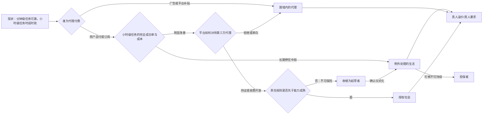

> 本文件是 2026-09-07 一次实际运行的产物，复制自运行目录，只删除了本机路径；内容未经人工修改。测试条件、宿主限制与抽查结果见[验证记录](../../evals/results/2026-09-07.md)。过程记录见 [exploration.md](exploration.md)。

# 到 2035 年：当 AI 代理替普通人办线上事务——工作、消费与人际关系的几种未来

**范围与口径。** 信号：AI 代理已能完成一部分多步骤线上任务。对象：不拥有 AI 公司、不做前沿研究的一般雇员、自由职业者、家庭成员、消费者。视野：2035 年。地区：互联网渗透率高的经济体，证据允许时区分中国与美欧。信息截止：2026-09-07。
**研究限度。** 本次运行中宿主的网页搜索工具全程故障，来源发现只能依靠 arXiv 站内检索、Hacker News 索引与已知网址，研究阶段读取 24 个来源，审查处置阶段另读取 5 个来源核验审查者的线索；这是一次**有边界的研究**，不是完整研究。多数能力数字来自厂商自报，已逐条标注。
**审查状态。** 草稿已交由一个没有生成历史的独立审查子代理审查（它只收到 `review-packet.md`，原文见 `review.md`；它核验了 10 项来源中的 9 项，法院案卷不可达）。生成方在收到审查结果前中止；处置由一个没有生成方对话记录的续写上下文依据文件完成，并核验了审查者的 5 条线索（另 1 条部分核验、1 条不可达），其余审查者凭记忆提出的线索在文中一律标"未核验"，不作为证据。逐条处置见 `exploration.md` 第 8 节。审查者、生成方与续写上下文共用同一模型，这不是独立佐证。

---

## 一、先校正三个容易误读的"现状"

1. **代理"能办事"的真实单位，是任务成功率随任务长度、错误可逆性与结果可验证性的分布，不是"能否替人"。** 在需要熟练人类一小时以上的任务集 OSWorld 2.0 上，2026 年 8 月厂商自报：Sai 的"部分完成度"73.0%，**完全成功率 28.25%**；GPT-5.6 Sol 为 62.6% 与 23.14%（另一模型 Claude Opus 4.7 的完全成功率 13.10%）；每任务模型调用成本 15.70–26.62 美元（[Simular，厂商自报](https://www.simular.ai/articles/sai-tops-osworld-2-0)）。METR 的度量显示，同一模型在同一长度的任务上大致三分之一总能成功、三分之一总失败、三分之一时成时败（[METR 时间视野页](https://metr.org/time-horizons/)）——但这是软件工程、机器学习、网络安全类可自动验证任务上的观察，"时间视野"衡量的也是低语境新人能做的任务（同上），推到日常事务是跨域类推。2025 年 3 月估计的"50% 视野约每 7 个月翻倍"已被 METR 在原文页首标注为过时（[METR 博客](https://metr.org/blog/2025-03-19-measuring-ai-ability-to-complete-long-tasks/)），最新数值本次未取得。委托意愿还取决于时长之外的两轴：错了能否撤回、结果能否核验——两分钟的不可逆付款与三小时的可逆调研，委托逻辑相反。
2. **网页世界在主动抵抗代理，而基准成绩不包含这种抵抗。** 基准维护者列出的失效原因包括验证码、"被网站识别为机器人"、IP 封锁、页面结构变化，并把受这些因素影响的任务修复或剔除了（[OSWorld-Verified](https://xlang.ai/blog/osworld-verified)）——基准分数因此是"平台不设防"条件下的上限。已上线的浏览器代理在自主模式下、加了防护后仍有 11.2% 的注入攻击成功率（[Anthropic，厂商自报](https://www.anthropic.com/news/claude-for-chrome)）；到 2026 年 7 月，跨站注入仍是活跃的研究问题（[Prismata](https://arxiv.org/abs/2607.08147)）。与封堵并行的还有第三条路：Cloudflare 于 2025 年 8 月推出"签名代理"，让站点用加密签名单独放行代表终端用户的代理（[Cloudflare](https://blog.cloudflare.com/signed-agents/)）。
3. **劳动力市场先动的是任务结构与招聘，不是失业率。** 美国工资单数据显示 22–25 岁在 AI 暴露职业的就业比同龄趋势低 19%，集中在 AI 起替代作用的职业，缺口来自减少招聘而非增加解雇（[Stanford，2026-08 修订](https://digitaleconomy.stanford.edu/publications/canaries-in-the-coal-mine/)）；丹麦行政数据则显示两年内收入与工时的效应为精确的零（排除 2% 以上），变化在于新增了"内容生成、AI 监督、AI 集成"等任务，但未说明这些任务落在哪个层级（[Humlum & Vestergaard, NBER](https://www.nber.org/papers/w33777)）。

这三点决定了下文所有未来的共同前提：到 2035 年，"能力"本身不是主变量；**哪些任务落入"总能成、错了可逆、结果可验"的桶，谁为代理付费，谁来授权与担责，代理访问平台的边界由谁划定**，才是把同一种技术推向不同生活形态的力。

---

## 二、六种未来：普通人的生活会有什么不同

六条路径可以重叠，也可能在不同国家、不同人群同时出现。前五条来自研究后的第二轮候选，第六条由独立审查提出并被采纳。不给概率，不给年份；每条只说"生活里的不同"以及"与常见叙事的差别"。带"示意"标记的小段落是虚构说明。

### 未来一：例外处理的生活
**生活里的不同。** 分钟级的线上事务（续费、改签、比价、填表、约号）被代理无形地办掉，你几乎不再"上网办事"。但你的注意力没有被解放，而是被重新分配到"时成时败"那一桶：判断哪些事能交出去、盯着交出去的事有没有跑偏、给跑偏的事兜底。办事便宜了，办事的**量**也涨了：你的代理会替你投诉、申诉、争取退款，对方的代理会同样勤奋地回应，一个普通家庭每年与机构的"往来次数"可能是今天的许多倍。机构的反应是加摩擦或加过滤：要求本人到场、生物识别、回电确认，或只接受持证代理。这条路预设有人为每次调用付钱（今天小时级任务每次 16–27 美元）、且分钟级消费者任务的可靠性接近 100%——现有证据只来自软件任务；若费用由广告或平台补贴，"你的代理"就是广告代理，这条路会滑向未来二。
**工作。** 对文员、客服、行政、基层运营来说，一天变成一条"例外队列"：常规流程由雇主的代理跑，人处理代理拿不准的那三分之一。"入门岗位变成盯代理的岗位"是假设：现有数据只显示年轻人被少招、新任务是监督与集成，没有显示入门岗位的内容已经转向监督。分支：分拣、盯梢、兜底也可以外包给低薪远程劳工，形成普通人看不见的隐形劳动层（审查者引 Ghost Work 与远程协助等案例，未核验）。
**消费。** "常备指令"取代购物：你给代理一组规则（预算、品牌、替代品是否可接受），只在异常时被叫醒。
**关系。** 直接影响小，但家庭里出现新的分工问题：谁管家里的代理、谁给孩子学校的表格授权，成为新的家务政治。
**失败条件。** "人盯代理"在人因研究中是已知的坏设计：长时间、低事件率的监督会让人漏掉例外（警觉性衰减）。这条路若持续，更可能滑向让中介兜底的未来六，或滑向确认仪式化的未来五混合态。
**与常见叙事的差别。** 常见说法是"代理帮你省时间"；这条路上时间没有被省下，而是被改造成警觉与核验，并伴随往来量膨胀。
> 示意（虚构）：晚上九点，手机上弹出三条"需要你决定"：药房换了替代药、房东的代理拒绝了你代理提出的维修时限、孩子学校要求家长本人到场做身份核验。你花二十分钟处理完，其余四十七件事今天已由代理办妥，你没看见。

### 未来二：围墙内的代理
**生活里的不同。** 你有代理，但它不是"你的"：它是电商平台的代理、支付平台的代理、超级 App 的代理。第三方代理进平台会被封、被诉、被限速；平台自己的代理则热情周到，只是它的推荐、比价和"最优方案"都在平台的货架和激励里。跨平台比价成为收费功能或不可能。
**三种围墙。** *单向围墙*：Amazon 自 2025 年 4 月起测试"Buy for Me"，用代理在其他品牌网站替顾客结账（[Amazon](https://www.aboutamazon.com/news/retail/amazon-shopping-app-buy-for-me-brands)），同时起诉 Perplexity 的代理进入自己的商店（见下）——平台放自己的代理出去，不放别人的代理进来。*持证围墙*：站点只放行有加密签名、登记在册的代理（[Cloudflare 签名代理](https://blog.cloudflare.com/signed-agents/)），配合"收费开放"（[Cloudflare pay per crawl](https://blog.cloudflare.com/introducing-pay-per-crawl/)）——既非封死也非开放，谁能拿到"证"成为新门槛。*国家拆墙*：审查者提到 2021 年工信部要求解除外链屏蔽的先例（未核验）；若重演，围墙可被行政拆除。
**中国变体。** 国务院文件把"新一代智能终端、智能体等应用普及率"（合并指标，未定义分母）定为 2027 年超 70%、2030 年超 90%，要求"安全稳妥有序推进"政务服务"全程智能办理"、发展"智能助理等服务新入口"；同一文件也提出"探索无人服务与人工服务相结合"，并把"自然人、数字人、智能机器人"并列为公共安全治理的对象（[国发〔2025〕11 号](https://www.gov.cn/zhengce/content/202508/content_7037861.htm)）。因此这条路上"不使用代理"的成本会上升，但人工渠道被政策预设保留（审查者另引 2020 年国办关于老年人运用智能技术困难的方案，未核验）；而"你的代理算不算你"在中国更可能由行政分类回答，而不是由法院逐案回答。
**美国变体。** 边界由诉讼与平台条款逐案划定。Amazon 诉 Perplexity 是一个进行中的、事实模式很窄的案件（代理用用户自己的凭据登录用户自己的账户）；生成方读取的案卷条目显示地区法院 2026 年 3 月准予初步禁令、第九巡回上诉法院 8 月撤销并发回（[法院案卷](https://www.courtlistener.com/docket/71874820/amazoncom-services-llc-v-perplexity-ai-inc/)），但审查者与本次续写均无法访问该案卷复核，且撤销初步禁令通常只涉及禁令标准，不是对访问授权的实体裁定。
**工作。** 雇主给的代理向雇主汇报；个人代理在工作场合被禁。平台劳动者面对的是平台的代理在排班、定价、评价。
**消费。** 默认代理捕获决策；"忠诚"从人对品牌变成代理对平台。付费者得到独立代理、免费者得到平台或广告代理，是这条路与未来四之间的分层线（假设）。
**关系。** 社交与礼物、聚会安排若也经由超级 App 的代理，关系的一部分后勤会被平台看见并定价（推测）。
**与常见叙事的差别。** 常见叙事默认"你的个人 AI 为你工作"；这条路上代理为入口的所有者工作，而普通人得到的是便利与被捕获的组合，围墙还可能是单向的或持证的。

### 未来三：真人溢价与真人要求
**生活里的不同。** 两种不同的"真人回归"要分开。真人**溢价**是消费者愿意为真人参与付费：客服里"找真人"要钱或要等级，关系里"我自己写的""我亲自去的"成为表达在乎的方式。真人**要求**是接收方为防欺诈、防损耗而强制真人到场（审查者引 2023–24 年多家零售商因损耗撤减自助结账、2025 年企业恢复面对面面试的报道，均未核验）。两者驱动不同、未来不同：前者是市场分层，后者是摩擦回归。Klarna 在裁员一年后重新招人并承诺客户可以找到真人（[CX Dive 二手报道](https://www.customerexperiencedive.com/news/klarna-reinvests-human-talent-customer-service-AI-chatbot/747586/)）；审查者认为这更像上市前的口径调整而非逆转（未核验）。国务院文件预设"无人服务与人工服务相结合"。
**工作。** 人际能力相对升值——WORKBank 的 1,500 名从业者访谈显示核心能力从信息处理转向人际（[Shao 等](https://arxiv.org/abs/2506.06576)）。经验断层是假设：美国数据显示年轻人被少招，丹麦数据显示新任务是监督与集成，两者都没有直接显示"入门岗位变成监督岗"；若成立，到 2035 年今天的 22 岁将是 31 岁，正是本应成为中层的年纪，机构不得不重新发明付费学徒制。溢价本身也可能只是过渡态（审查者引 ATM 与银行柜员先扩后缩的案例，未核验）。
**消费。** "真人做的、真人服务的"成为溢价商品；部分人反向以"全代理生活"炫耀效率。
**关系。** 拒绝委托成为身份边界（"我不让 AI 碰我的 X"）——这类拒绝与手工偏好有既有研究（见第五节）；美国公众已有一半认为 AI 会削弱建立有意义关系的能力，只有 5% 认为会改善（[Pew](https://www.pewresearch.org/science/2025/09/17/how-americans-view-ai-and-its-impact-on-people-and-society/)）。
**与常见叙事的差别。** 常见说法是"人情味仍然重要"；这条路把它拆成价格分层与反欺诈要求两种机制，并指出经验断层若成立，账单由入门者支付。

### 未来四：授权社会
**生活里的不同。** 执行的成本降到很低之后，瓶颈转移到授权与责任。支付基础设施把"人在场"与"人不在场"的购买做成两种有签名授权书的法律-技术类别（[Google AP2，60 余家机构参与，含 Ant International、银联国际](https://cloud.google.com/blog/products/ai-machine-learning/announcing-agents-to-payments-ap2-protocol)）——这一划分与可逆性相关但不等同：授权时有人确认，不等于错了能撤回。商户在拒付责任理清之前观望（[从业者观点](https://authoryze.ai/blog/the-reasons-agentic-commerce-hasnt-taken-off-yet)）。普通人的新家务是管理授权粒度：限额、类别、有效期，以及代理责任保险（审查者称现有产品仅企业级，尚无消费者市场，未核验）。审查者还回忆人民银行对刷脸支付要求用户主动确认——若属实，"人在场"在中国支付里已是既有类别（未核验）。
**缔约与责任。** "你的代理算不算你"在缔约层面并非悬而未决：美国联邦 E-SIGN 法规定，只要电子代理的行为在法律上可归于本人，由其缔结的合同不得因此被否定效力（[15 U.S.C. §7001(h)](https://www.law.cornell.edu/uscode/text/15/7001)）。真正未决的是三件事：代理访问平台的授权边界、错误的责任分配、代理算不算平台条款意义上的"用户"。
**工作。** 工人给代理授权去谈排班、福利、零工报价；雇主的代理与工人的代理谈判，人只在僵局时出场。
**消费。** 授权书就是消费契约；争议的核心从"商品有没有问题"变成"这笔是不是你授权的"。
**关系。** 令人不适的人际事务——谈判、催款、投诉、分手后的财物清点、共同育儿的日程——交给代理，出现代理对代理的谈判（消费者规模的采用尚未观测）。沟通里的"披露悖论"：一项 2023 年实验（Google 式智能回复、约 200 对被试、实验室短对话）发现被怀疑使用 AI 会被负面评价，而实际使用却让对方觉得更合作、更友善（[Hohenstein 等](https://www.nature.com/articles/s41598-023-30938-9)）——这是方向性证据，推到 LLM 起草与代理谈判是类推；这一现象在"AI 中介沟通"研究中已有多年讨论（见第五节）。法规目前只要求给平台生成内容打标识（[《人工智能生成合成内容标识办法》](https://www.cac.gov.cn/2025-03/14/c_1743654684782215.htm)），不覆盖私人 AI 起草的消息——一个可指出的制度空白。回摆：外包亲密事务的既有研究显示结果是矛盾心理与再个人化，不是简单解脱（审查者引 Hochschild《The Outsourced Self》，未核验）；哪些话必须"人写"（道歉、求婚、悼词？）由这场拉锯决定。
**与常见叙事的差别。** 常见叙事把代理商务描绘成"无摩擦"；这条路上摩擦从"做"搬到了"授权"，关系里多出一层"刚才说话的是你还是你的代理"。

### 未来五：收缩为起草者
**生活里的不同。** 触发有两种：一次被广泛报道的代理欺诈或误操作事故；或者——审查者认为更可能——责任规则（产品责任、人类监督义务）使自主执行无法投保，平台自己把执行收回（审查者引欧盟 AI 法案第 14 条、欧盟新产品责任指令、中国网络安全法 2025 年修正，均未核验）。代理可以填好一切，但点下"确认"的必须是人。生活结构变化不大；变化集中在两处——入门工作被"起草自动化"挤压，和几乎所有书面沟通都经过 AI 起草。类比：监督型辅助驾驶主导了十年而未阻断技术进步，"执行前确认"可以持续很久（审查者类比，未核验）。
**混合态。** 确认步骤仪式化：像 cookie 弹窗一样被机械点掉。法律上是未来五，体验上是未来一，责任成了空壳。
**工作。** "确认经济"：有人被付钱当那个负责的人；盖章者多，做事者少。
**消费。** 停留在"用 AI 研究、自己下单"的形态——Adobe 数据显示生成式 AI 来源的流量在 2025 年初已比半年前增长 12 倍，但转化率仍低于其他渠道（[Adobe，厂商数据](https://blog.adobe.com/en/publish/2025/03/17/adobe-analytics-traffic-to-us-retail-websites-from-generative-ai-sources-jumps-1200-percent)）。
**关系。** AI 起草的消息无处不在；AI 伴侣被年龄分级与监管——美国青少年近四分之三用过 AI 伴侣，三分之一曾在严肃谈话中选择 AI 而非真人（[Common Sense Media，倡导机构调查](https://www.commonsensemedia.org/research/talk-trust-and-trade-offs-how-and-why-teens-use-ai-companions)），而四周随机对照实验没有发现分配使用的因果效应，只发现自愿重度使用者结果更差（[Fang 等](https://arxiv.org/abs/2503.17473)）。
**与常见叙事的差别。** 常见叙事假设"能力提升→自主权提升"；这条路上，责任与安全给自主权封顶，与能力无关。

### 未来六（审查后新增）：担保者
**生活里的不同。** 可靠性缺口不由你盯、也不由你确认，而由中介吸收：他们出售"保证办成"，自己投保、自己雇人兜底，像旅行社之于航班、经纪人之于交易。你买的不是代理，是结果。**先要发生什么。** 保险可定价（需要未来四的责任规则）、担保者能规模化处理例外（需要未来一的隐形劳动层或足够可靠的代理）。**谁在推。** 不想当监督者的普通人、想把责任卖掉的平台、看到新险种的保险公司。**新瓶颈与失败。** 担保者集中成新的守门人（回到未来二的结构）；担保只覆盖可核验的结果，不可核验的事务仍回到你手上。**最近似的既有讨论。** 本次未核对；这条路来自审查者对未来一（盯梢不可持续）与未来五（确认负担）失败的预演。

### 横切两条（审查补充）
- **代理不平等。** 采用度与人均 GDP 高度相关（[Anthropic Economic Index，厂商](https://www.anthropic.com/research/anthropic-economic-index-january-2026-report)）；付费者得到独立代理，免费者得到平台或广告代理。反向的正面路径——对老人与残障者"代理即无障碍"——本次未找到证据，作为假设保留。
- **操纵代理的经济。** 面向代理的搜索优化、广告与营销型注入：第三方内容能劫持代理是已确认的技术事实（[Prismata](https://arxiv.org/abs/2607.08147)）；谁影响独立代理的选择，是未来二"默认入口捕获"之外的另一条影响链。

---

## 三、比较：六条路径的分岔在哪里

| | 例外处理 | 围墙内 | 真人溢价/要求 | 授权社会 | 收缩起草 | 担保者 |
| --- | --- | --- | --- | --- | --- | --- |
| 决定性条件 | "时成时败"桶长期存在，且用户自付代理费用 | 平台拒绝、单向或持证开放第三方代理；或代理由广告补贴 | 人际/到场价值被市场定价（溢价），或接收方因损耗强制到场（要求） | 授权与责任制度先于能力成熟 | 责任规则使自主执行不可保险，或事故后监管收紧 | 责任可保险且例外处理可规模化 |
| 工作的中心 | 盯代理、兜底（或外包给隐形劳动层） | 用入口所有者的代理 | 人际、到场；经验断层（假设） | 代理对代理谈判 | 确认与盖章（或仪式化点击） | 担保机构的例外处理岗 |
| 消费的中心 | 常备指令+往来量膨胀 | 默认入口捕获；免费层=平台代理 | 真人服务成为溢价 | 授权粒度管理 | AI 研究、人下单 | 买结果不买代理 |
| 关系的中心 | 家务政治：谁管代理 | 后勤被平台看见 | 拒绝委托作为在乎的表达 | 披露礼仪与回摆 | AI 起草无处不在 | 影响小 |
| 什么会打破它 | 完全成功率在小时级任务上稳定超过 70% 且成本骤降；或监督者持续漏掉例外 | 法院或监管确立"用户代理=用户"，或国家强制互通 | 人际岗位相对工资未升；企业加回真人只因损耗 | 拒付/责任规则长期悬而未决 | 注入攻击在独立测试中降到接近零且责任可保 | 担保者集中为新守门人；不可核验事务无法担保 |
| 中国/美欧差异 | 相似 | 中国：合并普及率目标+政务入口+行政分类；美国：诉讼与条款；单向围墙两地皆可能 | 相似；中国政策预设人工层保留 | 中国支付机构在 AP2 名单内；"人在场"或已是既有类别（未核验） | 中国已有内容标识法规；欧盟责任规则（未核验） | 未研究 |

（图中的分叉是条件而非时间顺序；路径可叠加。制度——法院、保险、礼仪——的变化周期长于产品周期，2035 年距今九年，未必够走完任何一条。）

---

## 四、路径如何走通：先要发生什么，谁在推，哪里会停

**例外处理的生活。** 先要发生的：企业把常规流程交给代理并把"例外"制度化为岗位，且有人为代理按次付费。推动者：雇主的成本动机、员工"把无聊事交出去"的意愿（WORKBank 显示意愿因任务而异）。人的回应：核验疲劳、责任下沉，或把核验外包。新瓶颈：接收方被往来量淹没——curl 项目的维护者报告 2025 年约 20% 的安全提交是 AI 低质报告，有效率降到约 5%，声誉惩罚对新账号无效（[Stenberg，一手记录](https://daniel.haxx.se/blog/2025/07/14/death-by-a-thousand-slops/)）；法院是第二个领域：截至 2026 年 9 月，一个持续维护的数据库已识别 2,022 起涉及 AI 幻觉内容的裁决（[Charlotin](https://www.damiencharlotin.com/hallucinations/)），那里的回应是制裁与声誉，不是"到场"。求职申请、理赔、投诉可能复现同样的动力学（本次未找到直接数据；审查者提到 2025 年的相关报道，未核验）。停滞点：若小时级任务的完全成功率快速逼近人类且成本骤降，"时成时败"桶缩小，这条路并入授权社会；若监督者持续漏掉例外，则滑向担保者。最近似的既有讨论：Bainbridge 1983"自动化的讽刺"、"自动化最后一英里"、"参差的技术前沿"与 RPA 行业的例外处理话语（审查者列出，未核验）；本报告所加的是往来量膨胀与接收方回应形态这一反馈环。

**围墙内的代理。** 先要发生的：标志性判决或条款确立平台可以拒绝用户的代理，或平台自建外向代理而封堵外来代理，或政策把入口交给平台与政务系统。推动者：平台的流量与数据利益、出版方与数据商（RELX/LexisNexis/Elsevier 曾申请作为法庭之友支持 Amazon，据生成方读取的案卷条目）、国家的普及目标。人的回应：接受便利；少数人维持"手动生活"。新瓶颈：跨平台协调失效，"代理互通"成为反垄断议题；持证体系下，"证"由谁发成为新的集中点。分叉：若法院确立"用户代理=用户"或国家强制互通，平台被迫开放，路径转向授权社会。最近似的既有讨论：平台经济与"围墙花园"批评、算法管理研究；本报告增加的是单向围墙、持证围墙与行政分类这三种不同的"关门"机制。

**真人溢价与真人要求。** 先要发生的：企业发现纯自动化客服的成本转移到投诉与流失，并把真人做成产品层（溢价）；或接收方因损耗与欺诈把真人到场做成硬性要求（要求）。推动者：消费者对情绪与复杂场景的需求、劳动者对人际岗位的转向、反欺诈部门。人的回应：年轻人发现"做事"岗位少招，转向到场型工作或学徒制。新瓶颈：经验断层（假设）——监督者从哪里获得经验。停滞点：若人际岗位的相对工资并未上升，"溢价"只是修辞；若企业加回真人只因损耗，那是"要求"而非"溢价"。最近似的既有讨论：入门岗位挤压、Beane 的"影子学习"、非使用者研究与手工效应（审查者列出，未核验）；本报告增加的是把两种真人回归分开，以及学徒断层的时间表。

**授权社会。** 先要发生的：支付网络与监管就"人不在场"交易的责任分配达成规则，消费者级保险产品出现。推动者：支付机构（AP2 名单中的卡组织与支付宝、银联体系；审查者另提 Visa、Mastercard、OpenAI–Stripe 与支付宝、微信支付各自的代理支付轨道，未核验）、想扩大代理购物的平台、想减少不适社交的普通人。人的回应：学会像管理 App 权限一样管理代理授权；在关系中形成披露礼仪，也可能回摆到"重要的事亲自来"。新瓶颈：授权本身成为负担（"授权疲劳"），以及"我的代理替我说的话算不算我说的"。分叉：若责任规则长期悬而未决，路径退回收缩起草；若规则清晰而个人不想管授权，路径转向担保者。最近似的既有讨论：代理商务协议的行业讨论、AI 中介沟通研究、电子代理缔约法；本报告增加的是把授权粒度当成普通人的日常家务，以及把未决点从"身份"移到"访问边界与责任"。

**收缩为起草者。** 先要发生的：责任规则使自主执行不可保险，或一次被广泛报道的事故，或注入攻击长期无法在独立测试中压低。推动者：监管者、保险公司、受损的消费者。人的回应：安心，也无聊——"确认"成为工作，然后成为仪式。新瓶颈：确认者不真正核验（橡皮图章），责任成了空壳。分叉：若防御在独立评测中成熟且责任可保，限制松动，转向授权社会；若确认仪式化，体验上回到例外处理。最近似的既有讨论：AI 安全与"人类监督"要求的法规讨论、监督型自动驾驶的十年经验（审查者类比，未核验）；本报告增加的是这种收缩对入门工作与书面沟通的不对称影响，以及混合态。

**担保者。** 先要发生的：责任规则可定价、例外处理可规模化。推动者：不想当监督者的普通人、想把责任卖掉的平台、保险公司。人的回应：像买保险一样买"办成"。新瓶颈：担保者集中；不可核验事务无法担保。分叉：担保者成为新入口→围墙内；担保只限低风险事务→并入例外处理。最近似的既有讨论：本次未核对。

---

## 五、与既有讨论的关系（审查后修订）

初稿列了九个"常见讨论较少展开"的方向。审查者逐项给出了最近似的既有讨论（多为其记忆所及，本次只核验其中两项），处置如下。"较少展开"在本报告中只表示"本次检索与审查所及的基线未覆盖"，不表示无人提出。

**撤回"较少展开"（四项）**
- **披露悖论。** AI 中介沟通已是成型的研究议程（审查者列出 Hancock、Naaman & Levy 2020；Jakesch 等 2019；Schilke & Reimann 2025《透明度困境》；Reif、Larrick & Soll 2025——未核验）。机制保留在未来四，不再称新。
- **代理的法律身份。** 缔约效力早有法律（E-SIGN §101(h)，已核验；审查者另列 UETA §14、Chopra & White 2011、Kolt 2025《治理 AI 代理》、欧洲议会 2017 年"电子人格"辩论——未核验）。改题为"访问授权边界与责任归属"后仍属既有讨论。
- **监督成为入门工作与经验断层。** Beane 2019《Shadow Learning》与 2024《The Skill Code》、Bainbridge 1983、2025 年关于入门白领岗位的公开警告（审查者列出，未核验）。且现有数据只支持"少招"，不支持"岗位内容转向"。
- **非使用者与拒绝作为身份。** Wyatt 2003《非使用者也重要》、Fuchs 等 2015"手工效应"、"Not by AI"徽章、Luddite Club 报道、Merchant 2023（审查者列出，未核验）。

**缩窄后保留（四项）**
- **"时成时败"桶。** 机制久有讨论——Bainbridge 1983"自动化的讽刺"（人被留在最难的例外上）、Gray & Suri 2019"自动化最后一英里悖论"、Dell'Acqua 等 2023"参差的技术前沿"、RPA 行业的例外处理话语（审查者列出，未核验）。本报告所加的只是：把它放到普通人日常体验的中心，并补上可逆性与可验证性两轴。
- **发送便宜、接收昂贵。** 机制已有系统论述——Dwork & Naor 1992 以计算定价反垃圾邮件（未核验）、Adler 等 2024《真人凭证》直接论证 AI 使发送成本趋零（[arXiv](https://arxiv.org/abs/2408.07892)，已核验）；第二个领域实例也已存在（[Charlotin 数据库](https://www.damiencharlotin.com/hallucinations/)）。仍待展开的是分支本身：普通人遇到的会是过滤与凭证（垃圾邮件的路），还是真人到场要求（自助结账的路）。
- **授权书作为消费契约。** 支付业内已讨论（AP2 的 mandates 概念、Visa/Mastercard 框架、SEPA 直接借记授权与免密支付等既有制度；审查者另提 Busch 等 2025 论文，未核验）。仍待展开的是它作为普通人日常契约的社会学：争议从"商品有没有问题"移到"这笔是不是你授权的"。
- **国家目标与官方情感话语。** 对中文读者不新（陪伴经济、情绪价值的政策评论普遍；审查者提 2024 年国办银发经济文件，未核验）。保留的只是跨国对照：中国"推动+管控"双轨（推动见国务院文件；管控见审查者回忆的 2025 年 12 月拟人化互动服务征求意见稿，未核验）对美国"倡导机构限制+州法"（审查者提加州 SB 243，未核验）。

**保留为推测（一项）**
- **任务作为社交黏合剂的消失。** AI 代理语境下确实少见，但相邻机制久有讨论（Hochschild 2012、Illich 1981"影子工作"、Wu 2018《便利的暴政》、Putnam 2000、Oldenburg"第三空间"——审查者列出，未核验）。仍无证据，引 Hochschild 作机制来源。

**审查新增、未核对基线：** 担保者路径、付费模式分岔、操纵代理经济、代理不平等。本报告不称它们"较少展开"。

---

## 六、哪些观察能区分这些路径

| 观察 | 数据从哪里来 | 指向 | 若观察到相反情形 |
| --- | --- | --- | --- |
| 小时级任务的**完全成功率**（非部分得分）与每任务成本；同一任务集上按可逆性/可验证性分层的成功率 | OSWorld 2.0 排行榜与厂商报告；METR 80% 视野与 TH 1.1 更新（本次未取得最新翻倍时间） | 长期停在中段→例外处理/担保者；快速逼近人类且成本骤降→授权社会/围墙内 | 若 80% 视野增长明显慢于 50% 视野，"时成时败"桶会更持久 |
| 主流个人代理的收费模式：订阅或按次自付，还是广告或平台补贴 | 产品定价页；财报中的收入结构 | 自付→例外处理/授权社会；补贴→围墙内 | 若两种并存且用户可选，分层线落在付费能力上（代理不平等） |
| 平台对第三方代理的处理：诉讼结果、开发者条款、是否加入签名代理名单、是否自营外向代理 | 案卷（本次不可达）；平台条款；Cloudflare 代理目录 | 拒绝且自营外向代理→单向围墙；持证放行→收费站；确立"用户代理=用户"→授权社会 | 若平台自愿开放付费通道，"围墙"变"收费站"，两条路径合流 |
| "人不在场"交易的拒付规则；消费者级代理责任保险的出现（审查者称目前仅企业级）；欧盟责任规则的实际适用（未核验） | 卡组织与支付机构规则；保险监管公告；欧盟法规适用日 | 规则清晰→授权社会/担保者；长期悬置→收缩起草 | 若规则清晰但交易量不涨，说明瓶颈在意愿而非制度 |
| 年轻人在 AI 暴露职业的招聘缺口；"AI 监督/集成"岗位的层级（入门还是有经验者）；丹麦式登记数据的收入效应是否突破 2% | Stanford 系列更新；招聘平台数据；北欧行政数据 | 缺口持续且监督岗为入门级→经验断层成立 | 若监督岗多由有经验者担任，"入门岗位转向监督"的假设不成立 |
| 企业"加回真人"的原因：客户付费意愿（溢价）还是损耗与欺诈（要求） | 企业公告与财报；零售损耗数据 | 前者→真人溢价；后者→真人要求与摩擦回归 | 若两者皆无，真人回归只是过渡态 |
| 中国"智能终端、智能体等应用"合并普及率对 2027/2030 目标的完成；政务"全程智能办理"覆盖率；拟人化互动服务规章是否出台（审查者回忆有征求意见稿，未核验）；CNNIC 用户规模 | 官方统计与 CNNIC 报告（本次未取得具体数字）；网信办公告 | 目标达成且管控规章出台→"推动+管控"双轨 | 若普及率停滞，中国路径向自愿采用靠拢 |
| 人际沟通中 AI 使用的披露规范：平台是否给 AI 辅助消息打标、公众对"AI 写的道歉"的接受度 | 平台产品变化；民调（Pew 类） | 标识扩展到人际→披露礼仪成形 | 若公众担忧下降且无人在意披露，悖论消失 |
| 往来量与接收方回应：每个岗位的申请数、AI 幻觉裁决数的趋势、投诉量；回应是过滤/凭证/制裁，还是到场与生物识别要求 | 招聘平台；Charlotin 数据库；开源项目；监管投诉统计 | 量涨且以到场反制→例外处理+真人要求；以过滤凭证反制→持证代理 | 若接收方用代理消化而未加摩擦，膨胀被吸收 |
| "保证办成"类代理服务及其保险/赔付条款的出现 | 产品条款；保险产品公告 | 出现并规模化→担保者 | 若担保仅限低风险事务，路径受限 |
| 注入攻击在**独立**评测中的成功率 | 学术评测、非厂商红队 | 长期高于个位数→收缩起草 | 接近零且稳定→自主权上限松动 |

**目前无法测量的：** 一个家庭的线上事务有多大比例已由代理处理（没有时间使用调查的分类）；真实生活中"时成时败"桶的大小；代理费用由谁承担的人口分布；亲密沟通中隐藏的 AI 使用；代理对代理谈判在个人生活中的出现频率。

---

## 七、未决问题与本报告的假设

- 未决：小时级任务的可靠性会不会像分钟级一样在几年内趋近可委托？两个度量（时间视野与完全成功率）可能给出不同答案；METR 最新的翻倍时间本次未取得。
- 未决：Amazon 诉 Perplexity 的案卷无法复核，判决理由未读；该案事实模式窄，不能推广到所有第三方代理。
- 未决：中国的实际采用率与政务智能办理的覆盖（数字未取得）；审查者回忆的拟人化互动服务规章是否存在（未核验）。
- 未决：办事量膨胀是否会在求职、理赔、投诉等场景重现——直接数据未找到，审查者提到的报道未核验。
- 未决：审查者列出的监管清单（欧盟 AI 法案、产品责任指令、中国网络安全法修正、美国州法）均未核验；它们决定未来五的触发条件是否已经在路上。
- 假设：以上六条路径都默认没有出现新的科学突破改变代理的基本可靠性形态；若出现，属于另一类条件路径。
- 假设："普通人""地区"的口径由本次运行自行设定（见开头），未经用户确认；审查处置由未参与生成的续写上下文完成。

过程记录（第一轮候选、来源笔记、第二轮变化、审查处置）见 `exploration.md`，其中第 8 节为审查处置，由没有生成方对话记录的续写上下文记录；审查简报与审查原文见 `review-packet.md`、`review.md`，两者未改动。
